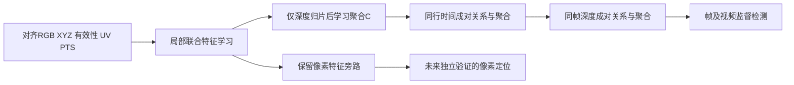

# 观看深度整片与关系正常性：设计纠正稿

**状态：设计阶段，供审阅；未实现、未训练、未验证效果。**
核对起点：`e05378d3d2c8a65d9b188190354463f2c3f3354a`；独立分支`pvst-depth-slice-design`。

|层次|几何单元与表示|研究任务/证据状态|
|---|---|---|
|用户原构想|沿观看深度切整片，形成“深度片×时间”特征表|本轮用户明确的概念；不能倒写成旧PVST已经实现|
|当前实现|XYZ三轴fine/coarse立方体；占据体素为节点；geo128、fine256/coarse512双尺度三层时序、点到像素旁路|源码事实：监督真假及编辑区域；现有资源结果不是关系正常性结果|
|本轮纠正|只沿观看深度切片，保留片内原生位置、有效XYZ和学习点特征，再研究片间时空关系|当前新设计：时间/深度独立成对关系、真伪监督检测；real-only预测移为备选，均未实现|

**把现有体素边长从1/8改为1，仍得到1×1×1立方体，不是原构想的a×1×c整片。**
原文y表示观看方向；在本缓存坐标中应改写为Z方向，整片是横截面全覆盖、Z厚度h。
本稿不替换旧代码/配置/资源记录；新概念边界见[ADR-0031](../decisions/0031-depth-slice-relation-design.md)。

## 1. 已核实事实与尚缺的几何证据

|核对对象|源码/元数据证据|可说与不可说|
|---|---|---|
|原生输入|[data.py](../../research_tools/pvst/data.py)：native_dense将dense256去padding后回映到原生HW；valid要求插值贡献有效且有限；Video保留原PTS/UV，XYZ除同一scale|原生像素上的插值可见表面估计；不是新增独立高分辨率观测或完整三维重建|
|坐标轴|本机MoGe/README.md说明OpenCV相机坐标x向右、y向下、z向前；moge/model/v2.py infer中depth=points[...,2]，可作projection约束并同时施加metric_scale；本仓MogeV2原样取points/depth|观看深度应为相机前向Z，既非Y，也非欧氏距离norm(XYZ)；不把用户y记号直接套数组索引1|
|尺度/单位|fit_scale从训练有效正Z按固定步长抽取，保存全局中位数；现有scale.json为1.9888148307800293，并声明camera-relative arbitrary scale；MoGe-2说明则称metric scale|存在“provider说明/本地持久化声明”差异。采用当前归一化坐标单位；本轮不认定缓存的物理米标定可信，后续核对checkpoint与单位lineage，不擅自更正旧资产|
|相机与配准|[full_video_streaming/inputs.py](../../research_tools/v8/full_video_streaming/inputs.py)逐帧MoGe，points直接patch保存；所查dense complete.json含provider哈希/frames/fields，未见相机外参、参考帧变换或注册证明；PVST不执行配准|当前camera-relative场，未发现跨帧共同世界坐标配准依据；CoTracker的其他旧字段不能冒充XYZ配准。此为已查路径/元数据结论，不声称全盘任何资产都不存在位姿|
|当前几何/时序|[geometry.py](../../research_tools/pvst/geometry.py) floor(XYZ/h)，coarse=floor(fine/2)；[temporal.py](../../research_tools/pvst/temporal.py)27空间邻域×同帧/t-d/t-2d，d=1/2/4|三轴体素与因果特征汇总；不是“深度片关系行预测”|
|当前学习目标|[model.py](../../research_tools/pvst/model.py)点/VFE/视觉/双尺度/像素与帧头；[v03.py](../../research_tools/pvst/v03.py) clip_terms/paired_order/train_one，调用frame BCE、AN pixel BCE+softDice；旧[train.py](../../research_tools/pvst/train.py)采用另一完整视频分母|当前是有真假/空间标签的监督检测，不是仅真实训练关系正常性；不能借现有成绩论证新假设|
|已有预训练|data.py官方加载路径去除LoRA的base DINO，但decoder读取AINPAINT已训练定位权重|不能将整个现有视觉路径宣称为未用伪造监督；新设计默认不复用该取证decoder作为“无伪造监督编码器”|

前轮设计稿仅核对源码和必要元数据；本轮追加六段冻结训练real的RGB/坐标CPU审计，不提取新特征或运行模型。

新设计定义原生像素(u,v)，有效相机点P=(X,Y,Z)，固定全局归一化P'=P/s，观看深度d=Z/s。
若未来改变坐标约定，必须显式给出前向轴/变换/单位再确定d，不能默认所有provider都用Z。
全原生RGB与像素索引保留；无效/遮挡位置保留valid=False、无切片归属，不插值补成真实观测。旧缓存内部的无效零填充值只是存储占位，必须连同valid读取，不能当原点上的有效点。没有观测的遮挡后表面不虚构。

首版适用条件：稳定或近稳定视角、前向深度在时间上足够可比。相机平移、旋转、焦距变化，逐帧估计的尺度/shift漂移都可能把同一表面移到另一片。
固定网格仅固定量化规则，**不证明跨帧几何已对齐**。后续应检查真实视频稳定背景的深度漂移/边界穿越、估计focal/shift可得性、camera-relative单位稳定性，区分真实物体运动与估计漂移；这些是质量审计，不是手工异常特征。本稿不自动引入新的配准、姿态或重建前端。

## 2. 深度分片与手算核验

共享原点d0、厚度h>0，定义绝对片号：

\[
i(u,v,j)=\left\lfloor\frac{d(u,v,j)-d_0}{h}\right\rfloor,\quad
S_i=[d_0+ih,d_0+(i+1)h).
\]

每片在另两个方向没有分箱：同深度区间内所有可见横截面位置可入同片，不要求图像连通，也不称物体/部位/刚体。片号不是跨帧点身份：C(i,:)描述深度区间内容，可因真实运动进出而改变。
同一序列共享相机轴约定、s、d0、h；不能逐帧min-max归一化、中心化或随机挪动边界。因果版本的参数只能来自训练数据或允许的历史，不能依赖未来极值。

**手算（仅示例，不冻结h=1）：** s=1、d0=0、h=1；示例相机fx=fy=100、cx=cy=100。

|点|原生(u,v)|有效(X,Y,Z)|d|片号|旧h=1三轴体素号|
|---|---|---|---:|---:|---|
|A|(10,100)|(-1.98,0,2.2)|2.2|2|(-2,0,2)|
|B|(190,100)|(2.52,0,2.8)|2.8|2|(2,0,2)|
|C|(11,100)|(-2.937,0,3.3)|3.3|3|(-3,0,3)|

三点满足示例针孔投影u=100X/Z+100、v=100Y/Z+100。
A/B相距180像素，均在[2,3)，**必须同片**；A/C仅相距1像素，但C在[3,4)，必须不同片。
旧三轴体素会拆开A/B，因此不是这个方案。边界d=3恰进片3；若d0=1而d=0.9则i=-1，不能向零取整。
无效点没有片号；片0/1无观测时M=False，不填C=(0,…,0)冒充观测。

保留每个有效点的原生线性索引vW+u、帧号、绝对片号。片号可稀疏存储，但不得按占据排序每帧重编号为不同深度。
不裁掉远处有效点以满足“最多32片”。逻辑m可变，保留实际绝对片号及空洞；空片/新片证据不足必须显式表示。

## 3. 从点到C：顺序、张量和保留内容

|张量|逻辑规格|语义|
|---|---|---|
|P_j、UV_j、native_id_j|[N_j,3]、[N_j,2]、[N_j]；N_j为全部有效点|不是每片XYZ均值；原生位置和有效点都保留|
|F_j=phi_theta|[N_j,K]|从原图局部邻域特征、UV及有效XYZ学习点表示；局部视觉不得读未来|
|slice_id_j|[N_j]整数|只作分组/映射；保持绝对深度标识|
|C(i,j)=Agg_theta({F,UV,P'} in S_i)|[m,n,D]|第j帧、第i个深度整片的D维学习描述；可用带位置条件的掩膜注意力/集合聚合，具体层数未冻结|
|M(i,j)|[m,n]布尔|有真实有效点且描述可计算；空/无效必须可辨，不作为连续真假特征|
|pixel_to_slice / 保留点特征|逐帧原生索引及F_j|供未来片内解释/定位，不把二维格设为时序节点|

C(i,:)表示同深度区间的观测变化，C(:,j)表示同帧不同深度层结构；j同时绑定原始帧索引与真实PTS，不假设等FPS。
先逐点编码再按片聚合，不能先把片压成人工均值/分位数。无需为每个片展开一张完整H×W×K高维图；可共享原图局部特征、流式点块和分组聚合，保留原生位置映射。
一片一个向量仍会压缩横向布局，位置条件聚合不能保证无损。因此保留UV和F有实际作用；本设计不把单个C说成完整平面内布局，也不以更多二维格替代深度片节点。

h、d0策略、K/D、窗长/历史秒数、聚合层数均待验证，不冻结h=1、32片或旧128/256/512为新方法参数。
后续仅用训练坐标查：全部有效点恰好归片、每帧/窗口占据片数和绝对跨度、空片率、片内点数、原生像素/有效点覆盖、跨帧边界穿越。不能以降低片数为由丢点。
令窗口有效单元数L=sum(M)，C存储O(LD)，全对全关系上界O(L²)，当前主线实际按行/列两类边计数，逐点编码另为O(sum N_j)；不将其混称像素对像素O((nHW)²)。本轮仅做六段CPU审计，未证明4090训练资源可行。

## 4. 当前主线：时间/深度分支的显式成对关系与真伪监督

2026-11-06按用户要求修订，取代前稿“仅真实关系预测”为主线的表述。
[ADR-0032](../decisions/0032-depth-slice-supervised-relations-audit.md)为当前决定；
旧方案移到本文末尾作为备选，不能与本主线同时实现或混用放行规则。

C(i,j)为第j帧、第i个真实深度区间的高维描述。同行是同区间随历史变化，
同列是一帧不同深度层的关系；同编号不代表同物体、同点集或配准已完成。
归片只决定像素归属；未来编码器接收对齐RGB/XYZ/几何有效性及原图位置，
先学像素和局部邻域的颜色、形状、点分布联合特征，再学习聚合。
有效性用于门控，不作为真假捷径或把无效XYZ零值当观测。
候选例子：每片4个池化头、每头64维再拼接，**仅示例**，不冻结维度、不声称布局无损；
不改成人工XYZ均值/方差/像素数拼接。几何无效像素仍保留在图像分支，像素特征旁路/映射保留。

设p=(i,j)、q=(i',j')，每条边先形成显式关系向量，再聚合：

\[
r_a(p,q)=\mathrm{MLP}_a\left((P_a C^a_p)\odot(Q_a C^a_q),\Delta_a(p,q)\right),
\quad a\in\{T,D\}.
\]

- 时间分支：i'=i、j'<j；Delta_T=PTS(j')-PTS(j)，同一窗口所有可用历史均可连。
- 深度分支：j'=j、i'≠i；Delta_D=(i'-i)h，即实际归一化深度区间中心差，
  不是按占据顺序重编号后的名次差，也不解释成米。
- 两分支分别学习P/Q/MLP及聚合参数；不预设越近越重要，也不将注意力权重解释成伪造概率。
  此处“二阶”指成对关系特征，不是二阶时间差分；不引入人工速度/加速度。

首版顺序：C^T输入取C，先对同片历史生成r_T并聚合到当前片表示H；
深度分支C^D输入取同一当前时刻的H，生成r_D后聚合，供帧/视频检测。
例如C(i-1,j-1)→H(i-1,j)→最终片(i,j)，只有中间片在j时刻可见时才有该两步路径。
不加直接斜向边，不能声称与全对全窗口关系等价。
空片不参与两类边；无历史时记录temporal_available=False，不能虚构零关系/零残差为正常。
当前C及图像分支可继续作为当前可见证据，但应单独报告无历史比例与对应检测表现。

主线使用真伪监督学习这些关系特征和检测头，因果检测**允许当前观测与历史，不读未来**，
不再采用旧稿整目标时刻遮挡预测的规则。可靠帧级区间/逐帧监督存在才用对应帧BCE；
只有视频标签则对有效帧汇总后用视频BCE，不得把视频级fake标签复制到全帧。
缺失监督保留unknown，真实遮挡/快速运动不天然是正标签。
帧/视频目标组合、汇总算子、训练队列和权重需实施前冻结，本轮不写成既定训练配置。
编码器权重/训练标签来源需记录；有过取证监督的初始化不能声称无伪造监督，
本主线本来就是真伪监督，不再以real-only作为卖点。

第一组待登记对照：同一像素编码器、C/切片、全部输入历史、数据、监督、可比容量及预算，
比较“保留同样时序上下文的直接汇聚”与“先显式成对关系再汇聚”，回答关系分支有无价值。
以后主张三维增益还需不使用深度归片的纯二维对照；只移除XYZ但保留depth slice仍用几何，不能叫纯二维。
本轮只登记，不实现。片分数不能复制为每个成员像素的精确标签；定位仍需像素旁路及独立GT验证。

规模定义：k_j为帧j占据片数，n_i为窗口中片号i出现帧数；
时间边sum_i n_i(n_i-1)/2（严格过去到当前），深度有向边sum_j k_j(k_j-1)。
这是完整可连接范围计数，不物化关系矩阵，不等于模型显存实测。

## 5. 当前小规模CPU审计与可证伪边界

按[固定审计规则](depth_slice_cpu_audit_v1_plan.md)和[样本清单](depth_slice_cpu_audit_v1_samples.json)，
只取训练real，各来源一段、每段最多24连续帧，选样不看深度稳定性。先人工RGB确认静态背景，
再用可复核的图像对应读取两端深度；同像素位置不等于同一物理点。
原生回映网格的插值点不是独立深度测量，归一化Z只除冻结s一次。
审计只判断背景可比性、切片边界敏感性与关系规模，不以这些人工统计量替代C或输入检测器。
结果见[审计报告](depth_slice_cpu_audit_v1.md)，其范围不能外推到所有真实运动前景。

可能推翻或削弱主线的证据包括：背景深度漂移主导关系变化；真实遮挡/运动导致系统误报；
几何有效性或片数成为标签捷径；时空自洽伪造漏检；关系分支不优于同上下文直接汇聚。
本轮不冻结厚度/原点/窗口/维度，不启动编码器、关系分支或训练。

## 6. 文献支持的范围

- [Stereo Magnification（作者页）](https://research.google/pubs/stereo-magnification-learning-view-synthesis-using-multiplane-images/)及[论文§3.1](https://arxiv.org/html/1805.09817v1)：MPI是固定深度平面的图像表示，保留平面内布局。仅支持“按深度分层不等于立方体”的表示思路；本稿的可见点分片/单向量聚合不是其RGBA平面渲染，也没有借此证明伪造检测。
- [Learning Self-Consistency for Deepfake Detection](https://openaccess.thecvf.com/content/ICCV2021/html/Zhao_Learning_Self-Consistency_for_Deepfake_Detection_ICCV_2021_paper.html)，[可读作者稿§3](https://arxiv.org/html/2012.09311v2)：显式学习图像位置间的关系，支持区别“关系监督”与普通特征汇总；训练用I2G合成不一致样本及相关监督，不是本稿深度切片因果关系检测的直接验证。
- [Self-Supervised Video Forensics by Audio-Visual Anomaly Detection](https://openaccess.thecvf.com/content/CVPR2023/html/Feng_Self-Supervised_Video_Forensics_by_Audio-Visual_Anomaly_Detection_CVPR_2023_paper.html)：真实未标注视频建模声画共现/同步并以异常取证，支持备选真实关系正常性这一研究范式；不证明深度片关系可预测或对本数据有效。

本轮已核对这些官方/作者页面；CVF直接页面部分访问403时用索引及作者稿核验，不虚构本方法的论文结论。

## 7. 实施前必须决定与停止边界

1. 核对缓存单位/逐帧深度可比性，以及稳定视角适用条件是否足够；没有配准证据时不能写成世界坐标。
2. 冻结d0/h、K/D、历史跨度及绝对片号/空片策略；用真实训练坐标审计占据/覆盖/关系规模后再定，不固定示例32片。
3. 冻结像素编码器/片内学习聚合及预训练标签lineage；主线允许真伪监督，不默认采用备选的固定观测编码器。
4. 冻结时间/深度关系向量规格、先时间后深度的聚合与无历史策略、同上下文直接汇聚对照和预算、帧/视频监督与误报评价。

这是设计纠正，不是现有PVST的等价执行优化或已有实验结果。离线双向窗口若将来研究，须单独登记，不能沿用本稿因果结论。本轮只更新文档与小规模CPU审计，旧代码/配置/失败结果/用户JSON原样保留，不实施模型、不训练、不做GPU测试或全队列计数。

本轮最小核验：标准库有理数手算复核三点针孔投影、深度片号、负值floor、两条关系行残差9/25与9/50，均一致；没有运行模型测试或GPU计算。

## 附录：前稿real-only关系预测备选（非当前主线）

以下保留前稿研究设想及其手算，不构成当前监督方案的执行合同，不与主线同时实现。

### 备选4. 关系学习：一个主目标与严格因果边界

研究问题：**在跨帧深度可比较的条件下，真实可见深度片是否具有可学习的时空关系，关系偏离能否提供单元特征之外的伪造证据？**

p=(i,j)、q=(i',j')，首个可审阅定义为冻结编码器描述的余弦相似度：

\[
R_{obs}[p,q]=sim(C_p,C_q)=\frac{C_p^\top C_q}{\|C_p\|\|C_q\|}.
\]

只有两端M=True且范数足以定义sim时有效；退化描述另记不可计算，不因加epsilon就将零向量假装正常描述。
每个单元的关系特征是其对可用窗口内其他有效单元的**关系行**，绑定绝对片中心差与真实PTS差。相近不必权重大，不把attention解释为物理因果或连接。
“用全局attention聚合得到一个向量”和“显式预测/评价关系行”不同；旧PVST做前者的一部分，不具备下面的关系监督与残差定义。

**备选设想：冻结观测编码器，只在真实训练视频上训练关系预测器。**

1. 目标时刻t到达后，用该帧可见点获得C_obs(:,t)及实际关系行，作为目标/评价分支。
2. 预测分支只能看τ<t的观测描述、绝对查询深度中心b_i=d0+(i+1/2)h及目标PTS；遮住整个目标时刻，包括目标RGB、XYZ、点/局部视觉特征、C、观测掩膜/占据数。编码器若有时间上下文，其历史输出也不得经预计算读到目标帧。
3. 预测器输出hat C(i,t)=F_psi(history,b_i,t)。对过去q用sim(hat C(i,t),C_obs(q))；对同目标时刻q=(i',t)用sim(hat C(i,t),hat C(i',t))。不能用真实目标帧其他片描述绕过整帧遮挡。
4. q只来自[历史,t]可用窗口，绝不含未来；排除p=q、自关系及无效端点。既有历史—历史关系不是该次预测目标，不靠大量易预测旧关系稀释损失。
5. 观测M仅在目标计算/评估选择有效项，不让预测器读目标是否有点。查询函数对任意绝对i都可定义且逐查询不依赖本帧占据模式；有限计算可按训练规则/历史预列查询。若目标出现预列范围外片，应保留点并调用同一个独立查询函数或记未覆盖/证据不足，不截断、不按目标分布重新归一化，也不能让目标查询集合间交互泄漏当前占据模式。该查询执行策略需实施前冻结。

主训练目标（只有这一项，不再叠加真假BCE/分割loss/特征预测辅助项）：

\[
\mathcal L_{rel}=\frac1{|T^+|}\sum_{t\in T^+}
\frac1{|P_t^+|}\sum_{p\in P_t^+}\frac1{|Q_p|}\sum_{q\in Q_p}
(\widehat R[p,q]-R_{obs}[p,q])^2.
\]

Q_p是上述有效非自身关系；P_t^+仅含Q非空目标片，T^+仅含有可评价片的目标时刻。逐时刻/逐关系行均值，避免点多/关系多的片自动支配；空分母不填0正常分数。损失权重与最终汇总规则须在正式评价前冻结。
片—帧证据e_p为该关系行的均方偏离；无有效关系时e_p=缺失、标记证据不足，同时报告覆盖率。帧/视频可按有效片/帧均值作首个明确候选聚合，阈值仅真实开发数据设定；这不是本轮已验证的检测器。

**防常量坍缩与预训练边界：**观测C及历史描述都来自同一冻结E_theta，不随L_rel更新；不能用训练中的预测器自身输出当观测真值。冻结包含参数、BN缓冲与统计模式，观测编码器使用确定性eval（关闭Dropout），历史/目标同一规则；不能只冻结权重却持续更新BN。冻结只阻止联合走向常量，不保证已有编码器有信息，应核查真实训练C的方差/有效秩和常量关系基线。
若点编码/聚合需要学习，先单独在真实可见数据做一个独立的掩膜重建任务：遮住被重建点的RGB/XYZ输入，以可见局部点及片描述、查询UV重建被遮住的真实RGB/XYZ，再冻结整个E（包括片聚合）。任务不能只重建查询位置或复制未遮挡输入；归一化、mask策略及独立监督细节实施前冻结。该表示预训练是独立阶段，不与关系主目标联合优化，本轮不执行。
推荐先考虑通用自监督视觉权重、重新学习的点/片聚合，**不沿用AINPAINT取证decoder**。即便base DINO/MoGe标称通用，也需记录权重来源与标签使用范围，不能凭名字证明整个预训练数据中没有任何伪造内容。若实际采用过伪造标签训练的权重，只能说“关系模块仅真实训练”，不得说全系统不依赖伪造监督。

### 备选5. 最小关系手算与可证伪实验

手算只检查公式，不模拟性能：历史有效描述H=(1,0)，目标两片观测C1=(1,0)、C2=(0,1)，预测hat C1=(1,0)、hat C2=(3/5,4/5)。
对目标片2，q为H、目标片1（排除自身）：观测关系行[0,0]，预测[3/5,3/5]，e2=((3/5)²+(3/5)²)/2=9/25=0.36。
目标片1的q为H、目标片2：观测[1,0]，预测[1,3/5]，e1=9/50=0.18。
此例所有描述已单位化；片2若缺失，相关关系删除，不能拿零向量计算；若没有任何q则证据不足。目标帧内关系两端都用预测值，手算中没有偷读C2构造预测关系。

首个实验只回答“关系正常性是否增加单元特征以外的证据”：

|条件|共同项|独立学习与评价|
|---|---|---|
|单元正常变化|同一冻结E、片划分、真实训练数据、历史/目标窗口、整帧遮挡和查询位置|同类预测器学习hat C与固定C的特征误差；以单元残差评价|
|关系正常变化|同上，匹配预测器容量/初始化规则与训练预算，评价同一批真/伪|只用L_rel，保留关系行残差；不混入单元损失后宣称关系贡献|

两者均只用真实样本训练，伪造用于冻结后的评价，不以伪造分数筛h或样本；真实开发用于阈值/正常性选择，测试与源视频隔离。数据范围/预算/容量匹配规则尚待另行授权冻结。
评价提案：帧/视频AUROC/AP、固定真实误报率下的召回与覆盖率；按实际编辑时段/类型与正常遮挡、快速运动、相机变化分别核对误报，不用fake中显眼异常挑样本。需要像素GT时只用于核对编辑，不冒充深度片真值。
第一阶段输出片—帧关系异常，不把一片分数广播给所有成员像素后称精确定位。像素定位须利用保留F/UV和独立片内证据，再验证GT对应及定位指标，属于后续任务。

以下结果可推翻或削弱假设：稳定真实场景的估计深度漂移引发大量报警；真实遮挡/人体动作产生系统误报；时空自洽伪造关系正常而漏检；关系相似度丢失单元异常且关系条件不优于单元条件；编码器描述近常量导致低残差但没有判别力。
全局旋转特征向量可保持余弦关系而改变单元特征，也是关系法的盲区。不能预设三维关系有效或优于二维/单元特征。
