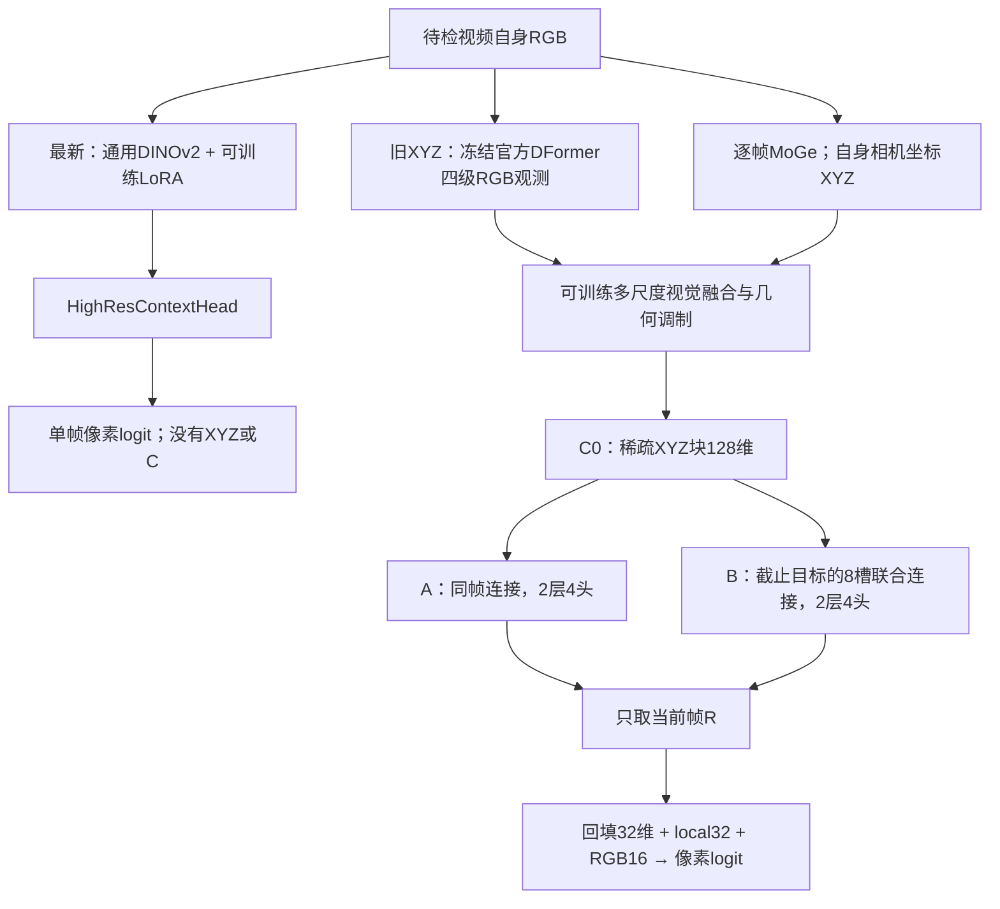
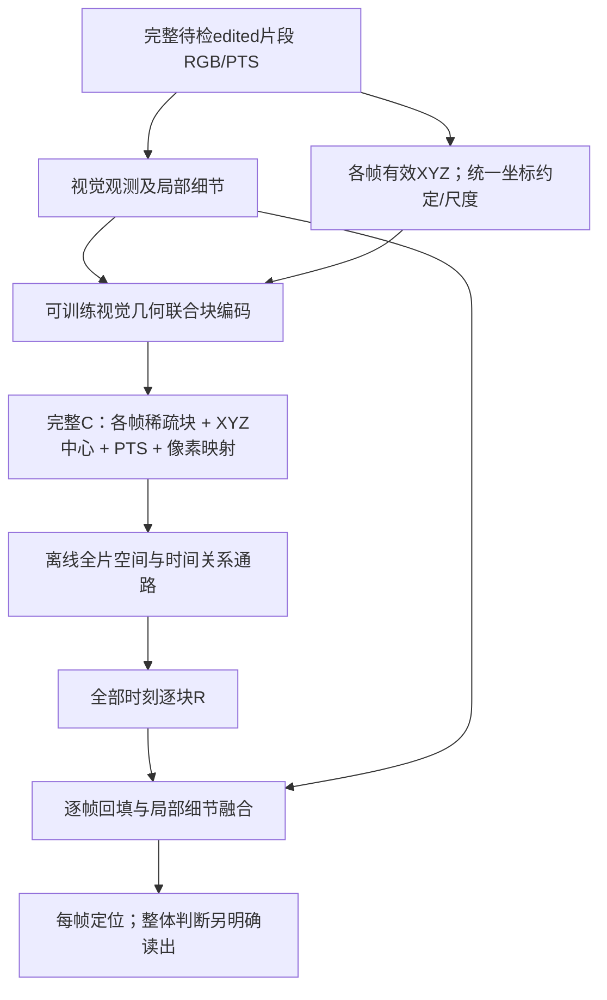

# PVST完整视频设计对齐 v1

日期：2026-11-24。性质：代码与已有产物的只读核查、待讨论设计，不是新模型或实验协议。

核查起点：`6d56a99168a221fd4d9e25b8c86d90850b0cbc1c`，工作区 `/media/njupt/8FCD3869E2FAB06F/chenyh/projects/pvst-geometry-dataset-screen`；新分支 `pvst-fullvideo-design-alignment-v1`，起始工作区干净。以下源码行号均对应此起点。本轮没有模型前向、训练、深度/视觉提取、资产下载或完整缓存重验；只用CPU读取一个观测包、一个检查点及现有JSON统计。

## 结论先行

**已实现事实：**旧XYZ定位模型确实按三轴切等边立方块，并进行可训练视觉—几何调制和学习式池化；较新关系层联合更新窗口内的全部有效块。但是，输入仍是截至目标帧的8槽窗口，最后仅输出一个目标帧。最近89来源的DINO空间模型完全没有接入XYZ、C或时间支路。

**用户原始目标：**实际待检trimmed/edited片段的完整时间范围形成C，离线学习跨位置、跨时间关系，保留逐块证据并输出各帧定位；没有“禁止目标之后帧”的要求。不要求重新下载长原片。

**主要缺口：**完整视频输入与多帧输出尚未实现；新的DINO视觉底座与旧XYZ块编码尚未接通；块内编码虽有几何信息，但不是显式点邻域/稀疏三维结构编码。以上不同缺口不能合并归因为某一层故障。

**唯一优先推荐：路线A，先实现完整片段C及全片关系通路，保留现有简洁联合块编码。**先纠正时间范围和输出单位，避免同时替换三维编码器而无法解释收益来源。下面的具体方案供讨论，不授权执行。

## 1. 术语、证据与历史范围

|术语|实际含义|不能混同为|
|---|---|---|
|训练观察 monitor|从训练视频固定抽取的356个目标；最新训练AP约.798→.870|完整训练集表现、三维特征单独能力、网络模块|
|HISTORICAL_DEV4|7e2e57、95q8g9、4xd3r9、7ogeg4；824帧|最终测试集|
|ADDITIONAL_DEV|新增15来源；4,328帧，检查点选择依据|独立于开发选择的测试集|
|EXPANDED_DEV|上述19来源、38视频、5,152帧|某种融合网络|
|C / R|联合块特征 / 关系更新后的逐块表示|伪造概率或注意力权重|

现有最新结果见 `docs/pvst/anakin_expanded_spatial_training_v1.md` 和数据根 `derived/pvst_anakin_expanded_spatial_training_v1/`。89训练来源、178视频、每轮22,878合法目标；10轮228,780更新。94测试保护来源未参与。19开发来源AP第1轮约.379856，第10轮约.313386；第1轮按ADDITIONAL_DEV AP从第1/3/5/10轮中选择，属于开发选择结果。官方标注技术核验后直接使用，不冒充逐条人工语义验收。

根设计契约§17、§17.1–17.11与ADR-0043至0054登记的是各次独立探针。旧因果窗口是这些探针的明确实现约束，不应追溯写成未经授权的错误；**它们也不等于本次重新明确的完整离线任务**。本轮只提出后续改动，不修改冻结契约、旧入口或结果；下一次若获准实现，须另登记取代范围与ADR。

## 2. 三条实际执行路径



|项目|最近89来源二维模型|旧XYZ同帧定位A|旧XYZ时空定位B|
|---|---|---|---|
|入口|`expanded_spatial.py:265 run`，其run.sh调用该模块|`insource_probe.py:227 run`|同左|
|模型|`ainpaint_spatial.py:33 SpatialBaseline`，`:48 build`|`insource_model.py:15 XYZLocalization`|同一个类，temporal=True|
|视觉初始化|官方通用dinov2_vitl14_reg，1024维/24层/4 register；LoRA r4、alpha8、dropout.25；官方空间头结构、新初始化|官方通用DFormer-S RGB-D权重，但外部depth常零；冻结四级RGB观测；PVST随机初值|与A对应参数相同随机初值|
|更新范围|LoRA 1,579,312 + head 2,094,017，共3,673,329；原DINO 304,372,736冻结|视觉融合、几何调制、池化、位置/时间、关系和定位头可训练；DFormer/MoGe冻结|同A|
|XYZ/时间|都无；T=1断言|XYZ；只当前帧|XYZ；8槽/.1秒截止窗口|
|帧分类头|无|无|无|
|输出/loss|单目标像素；BCE + soft Dice各1|同左|同左|
|数据|89来源全视频训练、19来源开发；228,780更新|7来源前70%训练1,026目标，后30%444目标；epoch10为10,260步|同A|

最新二维训练执行身份为 `258030e3a5dd41d7b50eaad0791141d908b6d309`，由结果目录identity记录；当前文档起点是后续结果整理提交，二者不能混写。二维缓存与训练调用见 `expanded_spatial.py:110–145,265–304`：模型在线计算DINO/LoRA，没有读取XYZ或旧C。

旧定位入口 `insource_probe.py:232–267` 创建ImageOnly/XYZLocalization及共同初始化；`:133–142 update`按一个目标做一次更新，`:146–177 evaluate`按原生帧评价。定位模型 `insource_model.py:18`删除父类的evidence/empty帧读出；`:48–51 losses`仅像素BCE和soft Dice。**不能因父类文件含帧头而说此定位实验仍在训练帧BCE。**更早 `XYZJointPilot` 的14700步实验确有块evidence、LSE帧读出及帧BCE，见 `joint_model.py:68–74`，是另一历史协议。

另外，`source_expansion.py`后来复用XYZLocalization，对7/11来源全视频合法目标各训练25690步；它依然不是DINO与XYZ的连接实现。不同训练范围的权重不能互相冒充。

## 3. XYZ来源、尺度与切块

证据：`data.py:64–86 compatible_geometry/remap_geometry`、`:90–139 extract_video`、`:187–199 Cache`；`model.py:11–15 route`。

- 每条real/fake用其**自身RGB**生成几何，或复用视频SHA、PTS及provider身份兼容的自身缓存；没有借配对real的XYZ预测fake。
- MoGe逐帧推断可见表面点；调用保留原provider相机坐标，没有世界位姿变换或点跟踪。既有provider约定为X右、Y下、Z前，当前代码不翻转坐标轴。本轮未新增provider数值验收。
- `remap_geometry`按有效权重回映XYZ至工作网格，并用有效性及有限性门控；无效位置即使存了零，也不路由为原点块。
- `Cache.get:193`做 `xyz = xyz_provider / scale`，一次统一标量缩放；不是每帧独立min-max。旧首轮/联合实验scale=12.699031352996826；同源定位及后来扩充为12.880994319915771，二者不可混用。
- 原点0、h=.5，键 `b=floor((XYZ_provider/scale)/h)`，三个轴一起取整，包含负坐标。块中心 `(b+.5)*h`。h=.5是归一化重建坐标单位，未经标定不能称.5米。
- 每帧仅保存有有效观测的非空块，所有有效点都归入一个键。未占据键不创建token；不能把未观测体积当成确认自由空间或物体消失。
- 这是可见表面稀疏表示，不是完整体积/世界重建。统一scale、原点与h提供一致量化规则，**不能保证单目逐帧尺度完全稳定或相机坐标已配准**。本轮不增加世界配准或共有键前置条件。

### 少量缓存实读（CPU，无路由/模型前向）

读取 `derived/pvst_xyz_temporal_pilot_v1/cache/9mygy9_fake/00100.pt`：frame_index=100，PTS=4.166666666666667，原生720×1280，工作216×384，pad224×384；XYZ_provider `[216,384,3]`，valid `[216,384]`，有效点74,675；RGB `[216,384,3]`，工作GT `[216,384]`。四级视觉分别 `[64,56,96]`、`[128,28,48]`、`[256,14,24]`、`[512,7,12]`。这确认缓存接口，不是本轮重新验证切块。此前同帧实际三轴路由及447块证据保留在 `docs/pvst/xyz_relation_review_v1.md`；不重复运行。

## 4. 联合块编码与DINO接口缺口

`model.py:56–78 encode_visual/encode`的实际张量流：

```text
四级DFormer特征 → 各级1×1投影128 → 自顶向下插值求和
→ 3×3视觉融合 → 工作网格V[H,W,128]
有效点a=XYZ/scale，块内r=a/h-floor(a/h)-.5
[a,r]六维 → MLP(6→64→256) → gamma,beta
x = MLP128(V * (1 + .1*tanh(gamma)) + .1*beta)
score(x)标量 + value(x)128维 → 每块内FP32 softmax归一化加权和
→ C0[N_t,128]
```

几何在逐点调制、score与value中参与学习，不是把最终几项手工统计拼接后直接分类。`[a,r]`拼接位置在可学习编码输入，不能据此说“完全没有联合学习”。但这里**没有Conv3d、显式点邻域消息传递或细粒度稀疏体素卷积**，属于逐点MLP/调制＋单头学习池化。它可能压缩块内多模态纹理、精细邻域排列、局部边界和点数变化；不能由代码断言具体哪些编辑证据已经丢失。归一化权重和为1，点数少不保证向量自动变稀疏；没有显式count输入。若后续确有支持缺口，可单独讨论学习式数量/支持度输入，不新增状态分类器，也不将有效率当异常规则。

### 最新DINO能提供什么（代码推导，不是新增特征提取）

`ainpaint_spatial.py:19–58`：ImageNet归一化，右下pad14；`forward_features`取`x_norm_patchtokens`，不把CLS/register当像素。ViT-L输出1024维，stride14。例：工作216×384→pad224×392→16×28 patch网格。

官方 `dinov2/models/vision_transformer.py:257–273,301–337`还提供prenorm与指定层patch中间输出；各层通常仍是相同patch分辨率，**不是现成的DFormer四级空间金字塔**。官方 `AINPAINT-CVIU26/ainpaint/modules/context_decoder.py:115–192 HighResContextHead`将1024→512投影，三次上采样256/128/64，final block32，再单通道predictor；例中网格为32×56→64×112→128×224，再将单通道输出恢复pad尺寸、裁padding、恢复原生。head内部32维图不等于旧Local.native或旧XYZ local32。

目前 `SpatialBaseline.forward`只返回像素logit，没有向XYZ编码暴露这些中间表示。接入至少需要：明确定义去padding/采样坐标；1024→128可训练投影；将相同有效XYZ点映射至视觉网格；显式返回定位细节表示及块—像素映射。不能直接将1024通道当作旧四级64/128/256/512，也不能把DINO和XYZ文件并存写成已接通。

## 5. C、拓扑和时序覆盖

### 稀疏C而非稠密视频体

`encode`返回C、position、keys、points、index、local。每帧C为 `[N_t,128]`，键为 `[N_t,3]`，N_t随观测变化；points为有效工作像素扁平索引，index将每个有效点映射到块。PTS来自帧包，帧身份与有效性另存，没有给模型输入文件路径、来源/集合标签。C是训练时生成的可训练中间量，不是可以永久复用的通用观测缓存。

逻辑C(i,j,k)：i对应实际帧及PTS，j是整数Z键，k可索引该层内的真实(X,Y)键；D=128是通道，不是第四个空间轴。`torch.unique`的排序只是存储顺序，不等于一维邻接。运动通过带真实坐标/时间的不同块token交互表达，不要求相同键一直占据同一物体。

|对象|物理/逻辑轴|区别|
|---|---|---|
|单帧XYZ体|X,Y,Z|本任务只观测表面，不是稠密实体体素|
|普通视频|T,H,W|二维画面随时间|
|三维视频|T,X,Y,Z|时间＋三轴空间；另有通道D|
|C(i,j,k)|时间、深度、展平XY索引|若直接沿(i,j,k)套Conv3d，错误假定k±1空间邻接；行尾/行首、空块跳号都会破坏拓扑|

### 真实关系计算

- `model.py:18–27 history_indices`：目标t及t−.1…t−.7秒，每槽选择不晚于请求时刻的观测。最远请求.7秒，不是整个视频。低帧率/不规则PTS时同一观测可重复选中；开头缺槽为None。
- `insource_probe.py:62–66 partition_history`进一步限制分区；`:93–96 PartitionCache.window`只有条件名XYZ_TEMPORAL读取历史，其余只当前。历史长度不是唯一观测数。
- `insource_model.py:20–29`跳过None，同一观测编码只算一次，但重复槽仍会追加重复token；不按共有XYZ键筛选历史。
- `joint_model.py:13–36 JointLayer`：每层归一化内容，Q/K=内容＋位置，V=内容；D128、4头、两层。position来自块中心MLP，time来自相对目标PTS的MLP。
- temporal=False按实际帧身份隔离；True在给定窗口内没有额外三角mask，因此**历史之间也互相更新，并可读取窗口中较晚的观测**。但窗口末端不超过目标，所以整体仍是截止目标推理。
- `joint_model.py:51`断言相对时间末项0且全≤0，`insource_model.py:24`限制帧PTS≤目标。`:65–66`只返回最后当前帧R，`:20–29`仅decode当前；当前空块时不借历史虚构当前块。

阻止完整离线建模的不是一个参数：固定8槽采样、条件驱动的窗口加载、未来时间断言、以目标为零且只用非正时间的调用约定、仅截取最后帧R、单目标loss与逐目标评价都要调整。时间MLP数学上能接收正值，不代表旧训练已学习过双向完整视频语义。A的同帧限制与B的跨帧开放也必须保留为明确对照。

当前没有显式“变化表示”或“变化之间的关系”模块，也无手工二阶差分。注意力可能隐式读取变化，**是否学会尚未由现有结果确认**。无需为术语再加导数、路径和或平滑损失。

## 6. 定位、监督与完整视频训练单位

`model.py:91–97 decode`：当前R投影32维，经index回填至有效像素；同块成员共享关系context，随后与local32、RGB细节16拼成80通道，经2D卷积/GN/GELU输出logit。无效几何位置context为零，但视觉/细节路径仍预测，正式计分不裁掉它们。块内像素可凭局部特征分开；不是每块只能输出一个常数mask。没有先帧分类再门控定位，没有在此定位模型中做全块均值帧判断。

GT用于监督、AP/FPR统计及合法目标排除；路由、块编码和关系不读取GT/版本真假标签，不按GT选推理ROI。40y1x9_fake[6,10)不监督/计分，可按原规则作为无标签历史；空真实GT不是缺失标注的通用替代。

当前每步一个目标，历史只有经当前损失传回的梯度；AP为正GT fake帧原生FP32 logit排序→视频均值→来源宏平均，Dice/IoU/召回/FPR固定logit≥0。没有AP@IoU实例匹配定义；当前定位入口不提供受训练帧头的ACC/AUROC。更早帧/视频AUROC/AP不能移植为此模型成绩。

**完整视频候选训练单位：**一个待检视频为一个逻辑样本，输入全部合法观测，输出所有T帧；每帧恢复原生计分，训练在有可靠标签的目标上累计同系数BCE＋Dice，先按合法目标帧平均，再按来源/real-fake预定权重聚合。工作网格loss与原生评价的区别继续报告。可分块解码、检查点和累积梯度，但跨片信息通路不detach；一个逻辑视频的更新不能随解码chunk数改变。

若使用重叠计算段，每个目标必须有唯一owner，监督权重及最终计分总计一次；若各段独立且无跨段信息，它只是分段模型，不是完整片段全局模型。主比较应同时匹配来源覆盖、有效监督目标呈现次数、像素范围与损失归一化，另报更新数和计算成本；不能只匹配更新数而一组每步监督1帧、一组监督整片。本轮不冻结新预算。

用户希望整体判断，但当前定位模型没有帧/视频头；未来可先由定位输出形成预先固定的帧/视频读出，或另立学习头协议。二者尚待选择，不能将注意力权重解释为伪造概率。本轮推荐主线先保持定位监督，不为设计对齐追加检测任务。

## 7. 可复用资产与全片规模

下表数据根统一为 `/media/njupt/8FCD3869E2FAB06F/chenyh/data/sparse_3d_forgery_detection/derived/`。

|资产|已登记覆盖/证据|缺口与复用条件|
|---|---|---|
|原片/fake/官方mask|扩充protocol 108来源、216视频；训练89、开发19|保留原视频隔离和94保护测试；不重新人工审阅作前置|
|工作RGB/GT|扩充 `preparation.json`：复用3397、新增24637帧，共28034；新增8,797,886,001字节|22878合法训练＋4排除＋5152开发；不是全部神经观测|
|MoGe/XYZ与旧DFormer|旧7train+4dev缓存2298帧，source_expansion新增4train后登记3397帧；15来源/30视频|其余93来源/186视频24637帧未在该扩充流水线登记兼容XYZ/DFormer；不据此宣称全服务器其他旧缓存绝不存在|
|通用DINO权重|官方ViT-L/14 reg4与revision/weight hash已登记|权重≠特征缓存；其他V8缓存不能未经身份/预处理核对复用|
|第1轮适配DINO特征|训练在线计算，没有登记整库特征缓存|通用DINO特征≠LoRA第1轮特征；未来冻结后需另提/验证，当前不计算|
|第1轮LoRA/head/BN|expanded `epoch01.pt`，`best_additional_dev.pt`指向它|不含通用基座完整权重，恢复还需原官方权重与相同构建|
|优化器/RNG/顺序|该checkpoint含optimizer、random_state；orders.json、BN_orders.json及identity|仅同结构续训可直接恢复，不能当新结构优化器已兼容|
|旧C/R|训练时由可训练参数生成|换视觉/块编码或继续训练后必须重算，不能跨权重共享|

本轮CPU实读epoch01.pt顶层为condition、epoch、updates、adaptation_state、optimizer、random_state、identity、initial_adaptation_sha256；adaptation_state有LoRA及head参数/BN缓冲，RNG含python/numpy/torch/cuda，identity含执行提交、protocol/orders/通用权重SHA与官方源码revision。没有模型实例化或重新恢复测试。所有旧报告、失败记录及数据不改。

### 规模依据与估算边界

CPU读取旧 `pvst_xyz_temporal_pilot_v1/scale_selection.json` 的现成node_counts，在其**原scale=12.699031352996826、h=.5**下求和；没有扫描观测包或重新切块：

|视频|帧数|每帧块数范围|全片M=ΣN_t|
|---|---:|---:|---:|
|4ym5n4_fake|96|7–8|747|
|4qwgw4_fake|75|46–58|3791|
|9l8w54_fake|96|66–94|7809|
|40y1x9_fake|150|45–338|23511|
|9mygy9_fake|120|425–456|52488|

这些是旧11来源清单记录的统计，不是89来源新规模，也不能当12.88099尺度的新路由实测。全片不同于“每帧几百块所以总共几千块”。

直接两层全token注意力计算量O(M²D)。仅一个4头BF16的显式注意力权重矩阵为8M²字节：M=747约.004GiB，M=23511约4.12GiB，M=52488约20.53GiB；这**不是实际峰值显存**，未含梯度/层/编码/定位，SDPA也可能不显式保存此矩阵。查询分块可减少临时内存，不消除二次计算。M=52488时每层QK与AV约4M²D≈1.41×10¹²浮点运算（D128，粗估，不含FFN/反向）。

旧联合实验资源日志3575窗口token/447当前块，峰值allocated/reserved约2.316/2.568GiB，是8槽实测，不是全片承诺。本轮没有任何新显存/耗时验收；全89来源实际块数与新DINO接口吞吐仍未知。

## 8. 目标流程与目标—实现对照



|用户目标|现有实现事实|匹配/缺口|推荐变更|
|---|---|---|---|
|等尺寸XYZ块|旧route三轴floor|符合量化，非米制/非世界配准|保留，注明相机坐标限制|
|联合块表示|逐点几何调制＋学习池化|已有基础，邻域结构弱|路线A先保留，路线B才换编码器|
|完整视频C|每目标8槽动态C|时间覆盖不符|完整帧列表、去重复观测、全片映射|
|跨位置跨时刻学习|B两层窗口联合更新|有局部窗口能力，无全片通路|明确全片交互设计，不只增H|
|离线可使用未来|加载/断言限制≤目标|旧探针约束，不是本次目标|新协议移除截止要求，保留真实PTS|
|逐块证据与各帧定位|仅当前R回填、单帧输出|空间映射可复用，多帧输出缺失|返回各帧R切片与各自映射|
|利用新视觉底座|DINO单帧与XYZ分开|接口未实现|明确1024→128及细节融合适配|
|学习关系的变化|隐式注意力|显式变化关系未实现，效果未验证|不硬加导数，先提供全片内容/位置/时间|
|公平训练比较|单目标每步|整片监督改变单位|匹配合法监督帧呈现量，另报更新/算力|

## 9. 两条候选路线

### 路线A（唯一优先）：复用联合块编码，建立完整视频关系通路

**本轮具体推荐方案，不是已实现或用户原始规定：**以第1轮适配DINO作为固定视觉观测起点，冻结通用DINO与LoRA；保持其head BN为eval。通过明确接口取得1024维patch观测及32维头部细节图，按工作有效XYZ采样，训练1024→128视觉投影、既有几何调制/点MLP/池化，输出每帧C0[N_t,128]。这不是声称整个骨干已学习了三维取证特征；冻结是降低变量与观测成本的研究选择，可能限制细微取证线索。

**全片关系采用可扩展的两阶段全局中继方案作为讨论默认：**

1. 每帧全部C0保留，先经同帧4头空间交互；每帧以8个可学习查询读取该帧全部块，得到S[T,8,128]。不是删除低分块，也不是用GT选ROI。
2. 全片S共8T个token，带真实XYZ来源信息及PTS，通过两层双向4头交互；每个块再查询全片所有更新后的S，并与自身空间表示残差融合，得到R[N_t,128]。块中心位置通过可学习XYZ嵌入进入Q/K；中继内容来自带位置的块，时间使用距片段首帧的实际秒数及相对PTS，不用任意帧编号距离替代真实时间。对跨帧消息可加入共享相对时间/XYZ偏置；具体实现需在下一轮配置冻结，不能宣称已有。
3. 全部时刻R各自投影32维、按原映射回填，和固定DINO头部32维细节融合，经小型可训练融合/像素输出层定位；无效几何保留视觉路径。不要求先完成帧分类，不用帧真假门控mask。

**能力承诺要准确：**输入覆盖全片；通过“任意源块→其帧中继→全片中继→任意目标块”存在跨全片、跨位置的信息路径；**不提供每对原始块的直接注意力，也不与完整M×M自注意力数学等价**。每帧8个中继是候选瓶颈，可能压缩小编辑证据。它保留逐块输出和局部残差，但不能保证中继未丢失信息。若用户要求所有原始块直接两两交互，应改用全token双向SDPA及精确查询分块，另实测全片资源；不得悄悄将中继说成等价执行优化。

该设计替换旧“空间层/目标窗口层”的组织，不在旧两层关系之外无意叠加另一套完整关系。空间和时间位置编码、各帧分段索引与padding有效性独立保留；不加显式出现/消失分类、运动导数或强制平滑损失。

接口改动限定为：新独立实验文件；`ainpaint_spatial.py`相邻薄封装暴露视觉/头部特征；复用`model.py`的路由/几何池化数学；新全片关系与多帧decode；独立数据collate返回完整视频帧列表、PTS和映射；loss/evaluate按唯一合法目标组织。旧入口不改默认。只缓存冻结视觉和XYZ，不缓存训练中变化的C/R。新结构优化器从新状态开始，不能无条件加载旧二维optimizer。

推荐保留定位监督BCE＋Dice，不立即新增帧头；整体判断若进入下一实验需另固定读出及评价，不把此路线包装成已有完整检测模型。**此前助手的“保留二维logit、关系只做修正”“XY/XYZ×同帧/时空四组”均未实现、未定稿，也不是用户原始要求；本主方案不强制采用logit残差或四组。**

后续最小对照：同一视觉、块编码、融合/定位、参数初始值、监督覆盖和预算下，A在中继交互及回读中屏蔽跨时刻连接，B开放全片连接；两组都覆盖完整视频并输出每帧。参数量相同，但计算量不同须报告。它回答全片时间信息通路的增量，不证明三维优于二维。先不替换成熟3D编码器、加更多来源或开四条件搜索。

复杂度粗估：中继全局(8T)²、逐块读中继M·8T、同帧空间ΣN_t²；不再有M²原始块全局项，但显存仍含可训练全片编码与解码，尚未实测。减少计算不构成性能保证。

### 路线B：成熟局部三维编码，再接完整视频关系

输入是有效表面点 `[P_t, XYZ+visual]` 及像素索引，采用成熟点邻域编码或稀疏3D卷积，在各帧实际XYZ坐标学习局部结构；再按同一输出立方块聚合为 `[N_t,128]`，接上述全片关系与逐帧定位。局部三维编码负责块内及近邻几何/视觉，关系模块负责远处与跨时间，不能把局部卷积称为完整视频全局理解。

一种具体可实施候选是稀疏3D小型U形编码：有效点先投至较细XYZ格，稀疏卷积在真实三轴邻接上传递，最终聚合回既定h块；保留点/像素细节旁路和稀疏坐标映射。细格间距、层宽及空格语义必须新定，不从医学体数据直接照搬。冻结同一DINO/LoRA以便研究几何编码变化，不声称医学或点云预训练权重必然适配本任务。

复用RGB/XYZ/PTS、合法目标与像素指标；必须替换`model.py`的point/score/value接口或新增独立3D编码文件，适配稀疏后端CUDA、坐标量化和跨层映射；仍需修改完整视频数据/关系/读出接口，不能只换3D编码器就解决时间范围。新依赖、细网格成本及空观测处理明显高于路线A。路线B可以回答局部结构编码的价值，但一次同时更换编码与时间范围无法单独归因。

### 一手文献提供的启发与边界

- [PointNet原作者页面](https://web.stanford.edu/~rqi/pointnet/)：逐点共享映射与对称聚合可以处理无序点集；没有Conv3d不等于没有三维输入。旧PVST的调制/softmax池化不是完整复现PointNet，也没有由此获得成熟局部邻域能力。
- [Minkowski时空稀疏卷积论文](https://arxiv.org/abs/1904.08755)：稀疏坐标张量上的广义卷积是可借鉴的三/四维路径，真实坐标邻接不同于展平块编号。其工程后端与本任务表面观测接口需要实际适配。
- [P4Transformer原论文](https://openaccess.thecvf.com/content/CVPR2021/papers/Fan_Point_4D_Transformer_Networks_for_Spatio-Temporal_Modeling_in_Point_Cloud_CVPR_2021_paper.pdf)：原文摘要采用局部时空嵌入和Transformer处理点云序列，可启发无需显式跟踪的跨位置交互；本轮CVF正文访问受限，仅依据可检索的作者论文摘要，不据此确定其采样实现或资源。不能默认它保留本任务全部有效像素及立方块基元。
- [3D U-Net原论文](https://arxiv.org/abs/1606.06650)：面向体数据的三维编码解码可启发空间局部结构；医学扫描通常有体素采样与明确体积拓扑，单目数据只有可见表面、未观测区域及可能漂移的尺度。不能把后者填成可靠实体体积，也不能假设医学权重能直接解决视频伪造。

不因架构成熟预设3D卷积必然优于点编码；不在本轮安装、下载或实现任何后端。

## 10. 已确认、未确认与最多三项设计取舍

**已确认：**三轴量化；几何进入学习编码；较新B更新所有窗口token但仅输出目标；定位模型没有帧头；最新DINO空间模型不含XYZ；现有扩充RGB/GT不等于全覆盖三维观测；全片规模不能沿用8槽显存。

**未确认且不阻塞本轮交付：**扩充89/19来源在指定尺度下的块数分布；其他旧目录是否存在身份兼容几何的额外覆盖；新DINO→块特征是否保留细微编辑证据；压缩中继是否足够；完整片段的实际吞吐/显存；各低分的具体因果层。代码没有验证“关系变化必然异常”，本轮也不能据负结果否定所有时空关系。

需要讨论的取舍限三项：

1. 全片要求接受所有块经中继存在全局信息通路，还是必须每对原始块直接交互？本推荐前者，明确压缩限制；后者需精确SDPA全片资源实测。
2. 首轮是否接受冻结第1轮DINO/LoRA，将学习集中在联合块编码与全片关系/定位融合？本推荐接受以减少变量，不把它视作永久冻结原则。
3. 下一轮是否先只验证逐帧定位，整体检测读出另定？本推荐先定位；若必须同步检测，需要另外明确监督与视频汇聚，不让未训练帧分数冒充检测能力。

下一轮最小范围为：批准路线A具体配置与上述取舍后，另登记协议，补齐选定来源的兼容冻结观测，做一次必要全片前后向测量，再由用户决定训练。**本轮到文档结束，没有批准或启动该步骤，也不冻结训练轮数、预算或新模型参数。**后续长训练仍由Codex准备实时进度/日志脚本和简短预检，用户在终端/tmux启动；Codex不持续轮询等待。

## 11. 本轮交付检查

只新增本文；旧模型、训练脚本、设计契约和实验产物不变。检查范围：源码引用、缓存/检查点元数据与统计、Markdown及git diff。未运行模型或测试训练功能，文档变更不引入代码测试。发布状态以本轮最终Git回执为准，发布不改变已有计算COMPLETE状态。
