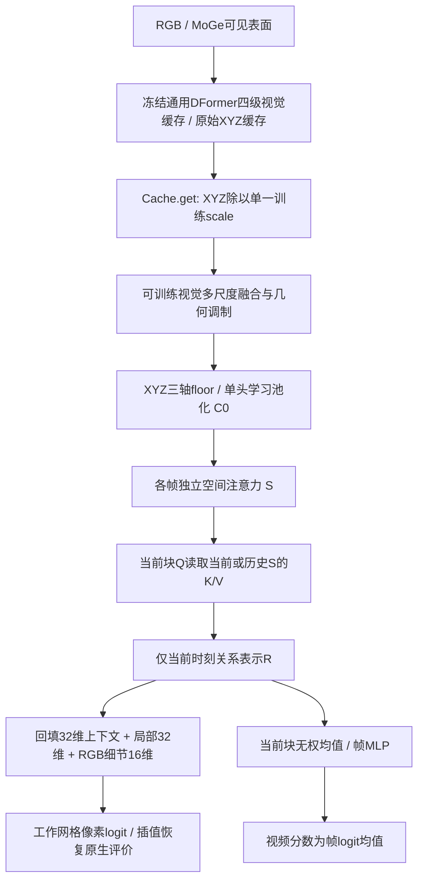

# PVST XYZ关系模块复盘与候选改造（待讨论）

本轮完成代码追踪和单缓存帧CPU核查；不改核心模型、不训练、不提取深度或冻结视觉特征。新关系模块只是一份待批准设计，不替代现行契约/ADR-0043，不执行14700步建议。

工作区：`/media/njupt/8FCD3869E2FAB06F/chenyh/projects/pvst-geometry-dataset-screen`；分支 `pvst-xyz-temporal-pilot-v1`。核查起点 `74a4b21b7cb5ac01032e32ae06016d984737eaf0`；原模型执行提交 `a1f320a1586078d7613c3415dc9d5df688040740`。当前 model/data/experiment 三文件与原执行提交逐字节相同。工作区起初干净，原实验与用户文件未改。

## 1. 先保存实际实现事实

以下描述来自执行入口和权重身份，不以研究构想替代源码。行号对应核查起点。主要源码：[模型](../../research_tools/xyz_pilot/model.py)、[缓存读取与准备](../../research_tools/xyz_pilot/data.py)、[执行入口与评价](../../research_tools/xyz_pilot/experiment.py)、[分类/空间指标](../../research_tools/v8/spatial_localization/metrics.py)。



| 问题 | 实际事实与证据 |
|---|---|
| 实例与权重 | `experiment.py:156–190`实例化`XYZPilot(h)`（`model.py:41`），不是`RGBDSetSlices`。末次为`XYZ_CURRENT_last.pt`和`XYZ_TEMPORAL_last.pt`，各576步，严格state_dict加载。B权重SHA256为`54f31ac5b998fd76c4bc8eea7dc92da583f355a0e98834c1173f3afd3d32a262`。完整A/B身份见新summary。 |
| 旧组件复用 | `data.py:17–23,94,123`复用官方DFormer加载器、几何尺寸、哈希与mask工具。通用DFormer只在准备缓存时运行，RGB标准化、深度通道为0、冻结eval；MoGe提供几何。`experiment.py:24–28`复用指标/解码/哈希工具。旧检测checkpoint、SlabPool、集合关系、GRU不参与本模型前向；导入某文件不等于实例化该文件所有模型。 |
| 坐标与切块 | `data.py:77–83,116,125,135–150,164–170`缓存是回映后的原始`xyz_provider`；训练帧正Z确定单一scale=12.699031352996826，`Cache.get`除一次。模型`route`（`model.py:11–15`）对归一化XYZ/h逐轴floor，h=0.5、原点0，键为三整数；不是Z整片或深度片×图像方格。既有坐标核验（`docs/pvst/depth_slice_relation_design.md:23`）依据MoGe说明与points/depth实现登记X向右、Y向下、Z向前；本轮准备代码直接使用该provider的points，未另行换轴。固定全局尺度并非世界配准或米制标定；跨帧重建漂移仍可能存在。 |
| 联合块编码 | `model.py:56–75`四级视觉特征侧连融合至128维，在工作像素上采样；几何MLP输入绝对XYZ与块内相对位置共6维，生成gamma/beta，调制视觉后经可训练point MLP。**一个**score softmax在完整块内归一化，再加权value聚合。不是四头旧SlabPool。特征保留可学习几何交互，但一个向量会压缩块内分布；成员数不作为显式输入，softmax归一化并不使“点少→向量稀疏”。 |
| C的实际存储 | `model.py:75`是逐帧稀疏dict：`C[N,128]`、`keys[N,3]`、`position[N,128]`、`points`及`index`映射和local图。代码中名为C的返回值已过空间层，不能与未过关系的C0混用。PTS在帧packet，valid在工作网格；没有巨大稠密C(i,j,k,D)。缓存只存观测，训练中的C可学习且重算。 |
| Q/K/V与范围 | `model.py:30–38,72–85`空间层Q=K=C0+块中心位置，V=C0；关系层Q=S_t+P_t，K拼接各可见帧S_s+P_s+T(PTS_s−PTS_t)，V拼接S_s。两层各4头128维，Q/K先LayerNorm再内部线性投影，残差+FFN。当前位置在空间层残差中已出现，读出又加位置。A只当前，B当前+历史；不要求同块键，允许跨位置。 |
| 更新范围 | `model.py:95–103`逐帧空间更新后，只有当前块作为第二层query。历史只提供独立空间编码的K/V；不存在整个窗口全部块的联合更新，也没有历史之间的跨时刻更新。B已有当前→所有可见历史块的读取路径，不能说完全无时间交互。 |
| 头与汇聚 | `model.py:85,88–94`R_t投影32维回填像素，与local32和RGB细节16拼接解码。几何无效像素仍走视觉路径。独立帧MLP读R_t的无权块均值；`experiment.py:113`视频取帧logit均值。没有“先帧分类再门控像素”。 |
| 冻结/梯度 | 通用DFormer和MoGe不在可训练模型内；XYZPilot共640387参数可训练，包括视觉融合、几何调制、池化、关系、定位和帧头。`experiment.py:38–66`像素BCE、soft Dice、帧BCE等权，FP32计算loss、BF16前向，clip1。像素loss影响像素路径与共享关系；帧loss影响共享块/关系和帧头，不经过像素解码器。是否梯度冲突未测，不能由低分认定。 |
| 计分 | `experiment.py:81–118`原生全画面正GT帧pixel AP→视频均值→4条fake宏平均，real不混入AP。帧真假标签为官方mask非空；帧ACC用logit≥0，AUROC/AP用连续帧logit；视频级以真假视频标签与均值logit计算同类指标。`research_tools/v8/spatial_localization/metrics.py:16–33`定义分类与Dice/IoU/FPR。**没有AP@IoU、实例匹配或目标检测mAP**，像素AP不是AP@IoU。 |

实际工作分辨率长边≤384，padding到32倍数；视觉特征恢复到padding尺寸后裁回工作网格。GT在工作网格最近邻缩放用于训练，像素logit双线性恢复原生画面用于最终计分。原生评价不等于原生分辨率编码，不把本紧凑探针称作旧v0.2完整规格。

历史按实际PTS取8个时间位置，间距0.1秒，覆盖最多0.7秒；每槽取不晚于指定时刻的观测，缺失保留None，可能重复同一观测。A不读历史。坐标一致的网格不意味着估计表面精确跨帧配准。

已保存记录核对：每组576更新、各288次real/fake，476个唯一目标；可监督训练目标1470/1474帧（fake40y1x9的6–9排除），开发824帧。A/B宏AP分别0.0693995577/0.0709871809，2增2降，三个明确运动来源平均增量−0.00142291；real FPR约0.06398/0.07627，视频AUROC均0.5。倒序微小变化伴随未变绑定目标的数值差异，不能证明明确顺序依赖。本轮没有重评分。

## 2. 单缓存帧实际前向

入口：`research_tools/xyz_pilot/relation_review.py`；实际调用`Cache.get → XYZPilot.forward → encode → 原route`，用临时只读包装记录route返回后立即恢复。B权重严格加载；两份末次checkpoint条件、576更新、共同初始化、config/manifest/model SHA均与run_identity一致。

| 项 | 核查结果 |
|---|---|
| 帧 | `9mygy9_fake/00100.pt`；零基100，PTS=4.166666666666667s |
| 原生 / 工作网格 | 720×1280 / 216×384；输入XYZ `[216,384,3]` |
| scale / h | 12.699031352996826 / 0.5；直接验证缓存xyz_provider/scale与实际输入逐值相同 |
| 路由 | 74675有效点 → 447非空块；keys `[447,3]`；每点恰一块，反索引重建floor坐标完全一致 |
| 同Z不同XY | `(-1,0,0)`和`(0,0,0)`同时存在，确认并非仅按Z分片 |
| 成员数 | 块内最少1、最多10073，总和74675 |
| 实例 | `XYZPilot`，space/context各128维4头；无SlabPool/RGBDSetSlices实例 |
| 输出与冻结 | pixel `[216,384]`、frame均有限；模型参数/缓冲区、指定缓存、A/B权重未变 |

这是一帧CPU FP32计算（原视觉缓存FP16由Cache转FP32），没有加载历史帧；仅核实B模型实际路由和模块，不声称复现历史BF16完整窗口预测。核查主体约0.3秒；含Python/库启动命令约3秒。两项直接测试通过：负坐标floor/XYZ区分/成员守恒、损坏反索引被拒绝。新增深度0帧、冻结视觉编码0帧、训练0步、GPU任务0个；脚本正常结束，退出码0，无本任务残留进程。

复跑命令（在上述工作区）：

```sh
CUDA_VISIBLE_DEVICES='' PYTHONPATH=. /media/njupt/8FCD3869E2FAB06F/chenyh/envs/v8/bin/python -m unittest discover -s tests -p test_xyz_relation_review.py
CUDA_VISIBLE_DEVICES='' PYTHONPATH=. /media/njupt/8FCD3869E2FAB06F/chenyh/envs/v8/bin/python -m research_tools.xyz_pilot.relation_review
```

新证据目录：`/media/njupt/8FCD3869E2FAB06F/chenyh/data/sparse_3d_forgery_detection/derived/pvst_xyz_relation_review_v1/`。summary保存完整身份、源码SHA、路由、模块类型与既有块数统计；不保存响应图或额外特征。

## 3. 与最新研究设想的对应

| 分类 | 结论 |
|---|---|
| 符合、可复用 | 等尺寸XYZ块、固定全局scale、几何与视觉联合可训练调制/池化、真实位置与PTS、跨块历史读取、像素旁路、无GT输入关系。 |
| 当前探针简化 | 通用骨干冻结、长边384、单尺度D128、空间1层+当前query读出1层、全块均值帧头、每步仅一个目标。 |
| 结构上未提供 | 全窗口每块的多层跨时刻更新；显式成员数/覆盖变化输入；保留细粒度关系证据的整体汇聚。归一化池化不显式编码数量是事实，但其他特征也可能间接携带数量/形状信息。 |
| 尚不能归因 | 低分究竟来自训练覆盖、特征、读出、交互范围、几何漂移或编辑线索，现有结果不能单独确认。猫接缝旧热图不作为当前XYZ关系结果：其对应的是池化前256维特征的线性读出。 |

## 4. 主候选：两层窗口联合交互，保留逐块证据

这是供讨论的一份候选，不是已批准实现。D128、4头、2层、8个时间位置，先沿用本轮0.1秒间隔、相同scale/h/工作网格，避免同时更换空间表示。

**替换位置。** 保留现有融合、几何调制、point/score/value和像素局部路径。取得空间层之前的C0。用两层联合时空自注意力**接替现有space与context两层**；不先保留旧空间层再无意叠加两层。每层含注意力残差和FFN残差，全部窗口块都更新，得到R，而非仅更新当前query。

**张量流。** 每帧C0_s为[N_s,128]，拼成X[M,128]，M=ΣN_s；并列保留块中心XYZ[M,3]、相对PTS[M,1]和帧身份（仅作掩膜）。两层后R[M,128]，取当前帧R_t[N_t,128]回填像素。不要求共有键，不跟踪物理点，不对token展平编号求距离。

**位置。** 块中心=(key+0.5)h。第一版保留XYZ位置MLP和相对目标PTS的时间MLP：P=MLP_XYZ(center)+MLP_time(PTS_s−PTS_t)，在各层Q/K侧加入，V及内容残差保留内容。这样有真实空间位置与相对时间，但**没有显式两两ΔXYZ偏置**，不能宣称已编码特定距离规律；若将来要加相对空间bias，另行登记，不和本次主改造混做。多头不指定为时间/深度/XY轴，不强制近邻相似、不加平滑损失。

**因果范围。** 采用以t结尾的短窗口，窗口内部允许双向交互，唯一输出t。历史token可读窗口内较晚位置，包括t，但没有t之后的观测。若需要每帧输出，对每个目标建立各自截止窗口；不能把截止t算出的历史R当作当年截止s的因果输出。训练/评价用同一规则。缺失槽用有效mask，不补未来、不新增出现/消失状态任务。重复观测槽要保留清楚的槽身份并沿用同一采样合同；其有效性不等于独立观测数量。

**匹配A/B。** 两条件都实例化同样两层、全部位置MLP和输出头，初始化与目标顺序相同。A用按实际帧身份的block-diagonal注意力mask，只能读同一观测帧；B开放窗口内所有有效token连接。当前时刻自身token保留标准自注意力，两个条件规则一致。A的历史token也可计算但不影响t；不改空间模块/监督/参数量来构造额外差异。未来实现要核对SDPA与MHA掩膜语义。

**定位与整体读出。** 当前R仍逐块保留，沿用R→32维→成员像素，与local/RGB细节融合，几何无效像素仍有视觉路径，不用帧分类门控定位。整体判断建议先用一个逐块线性证据头e_b=wR_b+b，再用固定温度1的`logsumexp(e_b)−log(N_t)`汇聚帧logit，替换现有`MLP(mean R_t)`；它能让局部高证据参与整体判断，同时对块数作显式归一。保留帧级监督，但取消独立“先均值再MLP”的帧分类支路；证据头与像素路径共享R，不把注意力权重当概率，不新增块标签/辅助任务。仍用现有三项等权loss以便A/B一致。该读出可能放大孤立误报，也不是已证实优于均值；它的影响不能从未来新旧模型差值中单独归因。若要隔离关系改造本身，第一组A/B必须共用这一候选读出，不另加第三组。

**数量信息。** 主候选暂不强加成员数输入，避免把结构事实当成已确认病因。若后续确有需求，最小候选是每块`log1p(n)/log1p(HW)`经小线性层加到C0，两个条件共用，无额外状态监督。n是投影采样密度而非物理物体质量，受机位、深度、分辨率影响；不能将点少直接解释为异常。本轮不实现该项。

**缓存。** 兼容的通用四级视觉、原始XYZ/valid/RGB、PTS与GT可复用。路由keys/index在h/scale不变时可确定性重建。联合融合、池化C0、R均可训练，必须随参数重算并保留历史梯度，不能拿旧已过space的C当新C0、不能detach历史。eval固定权重可复用逐帧C0，但R依赖目标截止窗口，不应作为通用逐帧因果缓存。

## 5. 规模估算与下一次最小范围

仅从既有`scale_selection.json`的h=0.5逐帧计数和实际history_indices求和，没有扫描新缓存或运行新关系模块：

| 全部候选目标窗口 | 窗口数 | M中位数 | P95 | M最大 |
|---|---:|---:|---:|---:|
| 训练（含4个不监督目标，仅作规模统计） | 1474 | 843 | 3453 | 3575 |
| 开发 | 824 | 301.5 | 529.85 | 568 |

最大训练窗口为9mygy9_fake目标100，槽83/85/88/90/92/95/97/100；本次当前帧447块。联合层的注意力对数为M²=12,780,625/头/层；4头BF16显式分数张量约97.5MiB/层，两层合计约195MiB（只是形状载荷）。QKV约2.62MiB/层。SDPA可避免物化完整分数，但训练还包括梯度、FFN、融合图和优化器，**以上不是峰值显存或吞吐实测**。旧结构为逐帧ΣN_s²再加当前N_t×M；联合两层使所有历史也参与交互，算量会增加，不能以旧模型失败或旧验收成功替代新模块资源判断。

下一次若批准，最小范围是只实现上述替代关系模块与共用证据读出，登记配置/ADR后检查mask、跨位置跨时间通路、像素映射和完整梯度；一次代表窗口资源检查通过再做匹配A/B，不同时增加来源、种子、层数或成员数分支。训练预算应在批准配置中另行确定，本轮不启动576步或14700步。

本轮确定的是“实际XYZ切块已成立”和“旧B只更新当前query”。联合更新与局部证据读出值得作为具体候选讨论；尚无实验证据证明它们会改善定位或检测。
